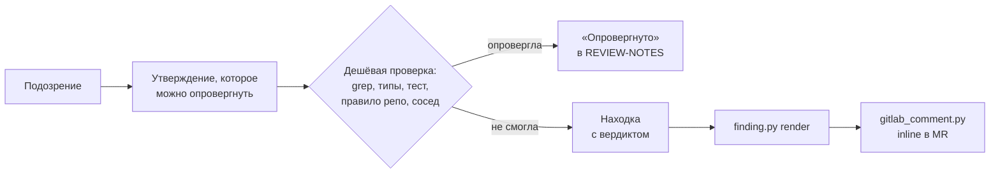

# gated-review

[](LICENSE)


**Code review для Claude Code и Codex, в котором каждое замечание сначала пытаются опровергнуть.**
Находка становится комментарием в MR, только если дешёвая проверка, которая могла её убить, —
`grep`, тип-чекер, тест, правило репозитория, соседний файл — её не убила.

> **English.** An evidence-gated code review skill for Claude Code and Codex. A finding is posted to a
> GitLab merge request as an inline comment only after a check that could have refuted it failed to.
> The posted comments and most of the docs are in Russian.

- [Что видит автор MR](#что-видит-автор-mr)
- [Как это работает](#как-это-работает)
- [Режимы и стеки](#режимы-и-стеки)
- [Установка](#установка)
- [Запуск](#запуск)
- [Публикация в GitLab](#публикация-в-gitlab)
- [Разработка](#разработка)
- [Структура](#структура)
- [Лицензия](#лицензия)

## Что видит автор MR

Один комментарий на находку, на той строке диффа, о которой он, — не на странице MR целиком.
Это настоящий вывод `finding.py render` для находки на `src/refunds/service.ts:48`:

> **[ai-review-bot]** · Приоритет: важно · Блокирующее: да · подтверждено
>
> Повторный возврат с тем же refund_id списывает деньги второй раз
>
> **Ломается при:** второй POST /refunds с тем же refund_id → клиенту возвращается двойная сумма
>
> **Что сделать:**
> - Проверять refund_id до списания
> - Добавить уникальный индекс на refund_id
>
> <details><summary>Как проверено</summary>
>
> `pnpm exec vitest run refunds.spec.ts`
>
> ```
> 1 failed | 12 passed
> ```
>
> </details>

Первая строка всегда одна и та же: приоритет, блокирует ли мерж и вердикт — **подтверждено**
(проверка запущена, её вывод приложен) или **предположение** (механизм реальный, но проверить не
вышло, и сказано почему). Вопросы автору и ответы в ветках тоже начинаются с `[ai-review-bot]`.

## Как это работает



**Шлюз.** Опубликованный комментарий — единственное платное действие в ревью: он тратит внимание
автора и доверие к ревьюеру. Всё остальное — `grep`, соседний файл, тип-чекер, прогон теста —
бесплатно. Поэтому находку нельзя опубликовать, пока она не прошла `scripts/finding.py`: у неё должно
быть проверяемое утверждение, сценарий «вход → что сломается», точная строка и одно основание —
команда с выводом, названный соседний файл или объяснение, почему проверить нельзя. Без этого
скрипт отказывает.

**Лестница доказательств.** Чем сильнее проверка, тем серьёзнее может быть находка:

| Ступень | Что сделано | Максимум |
|---|---|---|
| 0 | прочитан дифф | 🟢 nit |
| 1 | `git grep` по репозиторию и соседним веткам, прочитаны соседи | 🟡 желательно |
| 2 | типы, линт, сборка | 🟡 желательно |
| 3 | прогнаны существующие тесты по этому пути | 🔴 блокер |
| 4 | написан падающий тест или воспроизведение | 🔴 блокер |
| 5 | запущено приложение | 🔴 блокер |

Блокер на одном прочитанном диффе скрипт не примет:

```text
ОТКАЗАНО

серьёзность 🔴 blocking не опирается на рунг 0 (прочитал diff).
На этом рунге максимум: nit.
```

**Заметки, которые переживают сжатие контекста.** Длинное ревью не помещается в контекст модели.
Всё состояние — находки, опровергнутые гипотезы, покрытие, план — лежит в `.review/` и одной
странице `REVIEW-NOTES.md`, которую скрипт пересобирает после каждой команды. После сжатия
контекста ревью продолжается с этой страницы, а не с начала.

**Повторное ревью.** После правок рабочий список — открытые ветки `[ai-review-bot]` в MR. Ветка
закрывается только после повторной проверки на новой ревизии, а не по словам «поправил».

## Режимы и стеки

Режим выбирается аргументом или одним вопросом в начале ревью:

| Режим | Что проверяет | nit в MR |
|---|---|---|
| `business` | реализованы ли требования тикета и верна ли бизнес-логика; требования цитируются, у каждого статус с доказательством | 0 |
| `design` | стайлгайд, архитектура и дизайн кода по правилам самого репозитория; замечание цитирует строку правила | до 5 |
| `security` | инъекции, доступ, секреты, небезопасные API | 0 |
| `full` | всё вместе — по умолчанию | до 5 |

Стек определяется по изменённым файлам и ближайшему манифесту: `ts-react` (React 19, Vite SPA),
`node-nestjs`, `typescript`, `python-fastapi`, `python`. План ревью перечисляет справочники для этого
стека и команды на каждой ступени лестницы — только инструменты, которые в репозитории уже есть
(pnpm/yarn/npm, uv/poetry).

## Установка

Требования: `python3` ≥ 3.9 (скрипты только на стандартной библиотеке), `git`; для публикации в
GitLab — [`glab`](https://gitlab.com/gitlab-org/cli) с логином или токен в `GITLAB_TOKEN`.

**Claude Code**

```bash
claude plugin marketplace add elenik72/gated-review
claude plugin install gated-review@review-tools
```

Обновление: `claude plugin marketplace update review-tools`, затем
`claude plugin update gated-review@review-tools`.

**Codex**

```bash
codex plugin marketplace add https://github.com/elenik72/gated-review.git
```

Затем включи **Gated Review** в `/plugins`.

**Без плагина** — симлинком на каталог скилла, для обоих агентов:

```bash
git clone https://github.com/elenik72/gated-review.git ~/gated-review
ln -sfn ~/gated-review/skills/code-review-skill ~/.claude/skills/code-review-skill
ln -sfn ~/gated-review/skills/code-review-skill ~/.codex/skills/code-review-skill
```

Выбери один способ: плагин и симлинк вместе загрузят скилл дважды.

## Запуск

```text
/code-review-skill business !482                  # при установке плагином: /gated-review:code-review-skill …
проведи ревью MR !482 по тикету PAY-42            # обычной фразой — скилл сработает сам и спросит режим
re-review the MR after the author's fixes
```

Агент сам ведёт шаги; скрипты лежат в `skills/code-review-skill/scripts/` и запускаются из корня
репозитория под ревью:

```bash
S=skills/code-review-skill/scripts
python3 $S/finding.py init --target origin/main --pr "!482" --mode business --stack auto   # печатает план
python3 $S/finding.py req --add "повторный возврат с тем же refund_id не создаёт второй" --source PAY-42
python3 $S/finding.py add --form breaks --severity blocking --rung 3 --claim … --breaks-when "… -> …" \
  --location src/a.ts:12 --evidence "pnpm exec vitest related --run src/a.ts" --output "1 failed"
python3 $S/finding.py render --json > /tmp/findings.json
python3 $S/gitlab_comment.py post-batch --mr group/project!482 --input /tmp/findings.json
```

`.review/` и `REVIEW-NOTES.md` создаются в корне репозитория под ревью; `init` добавляет их в
локальный `.git/info/exclude`, чтобы они не попали в коммит.

## Публикация в GitLab

`gitlab_comment.py` публикует только то, что прошло шлюз, побайтно так, как это отрендерил
`finding.py`; любой другой текст он отклоняет до первого запроса. После публикации он проверяет,
что каждый комментарий лёг на строку диффа (`DiffNote`), и удаляет свой комментарий, если GitLab
положил его на страницу MR.

- **Хост** — из `origin` репозитория под ревью; переопределяется `GITLAB_HOST` или `--host`.
- **Токен** — из `glab` (`glab auth login --hostname <host>`), либо `GITLAB_TOKEN` / `GL_TOKEN`.

## Разработка

```bash
cd skills/code-review-skill/scripts
python3 -m unittest test_finding test_gitlab_comment test_pr_analyzer test_review_plan
cd -
claude plugin validate --strict .
claude plugin validate --strict .claude-plugin/plugin.json
```

Evals для `claude plugin eval` — три кейса: подложенный баг, чистый MR без блокеров, невыполненное
требование тикета.

```bash
claude plugin eval . --scaffold --allow-tools "Bash(git *)" "Bash(python3 *)" --threshold 0.8 --no-publish
```

Каждый кейс прогоняется с плагином и без, это вызовы модели и стоит денег; `--max-cost-usd 0` только
проверяет, что кейсы загружаются. Версия меняется в `.claude-plugin/plugin.json` и
`.codex-plugin/plugin.json` вместе, тег — `claude plugin tag`.

## Структура

```text
.claude-plugin/{plugin,marketplace}.json   манифесты для Claude Code
.codex-plugin/plugin.json                  манифест плагина для Codex
.agents/plugins/marketplace.json           маркетплейс для Codex
skills/code-review-skill/
  SKILL.md                    процесс и шлюз; начинается с выбора режима и стека
  agents/openai.yaml          метаданные скилла для Codex
  reference/                  справочники по режимам, стекам и сквозным темам — читаются по плану
  assets/                     шаблоны сводки и заметок
  scripts/finding.py          шлюз находок, требования тикета, заметки, рендер
  scripts/review_plan.py      реестр режимов и стеков: что читать и что запускать
  scripts/gitlab_comment.py   inline-комментарии в GitLab только для прошедших шлюз находок
  scripts/pr-analyzer.py      размер PR и порядок чтения
  scripts/test_*.py           тесты (stdlib unittest, без сети)
evals/                        кейсы для claude plugin eval
```

## Лицензия

[MIT](LICENSE). Справочники по языкам и сквозным темам основаны на
[awesome-skills/code-review-skill](https://github.com/awesome-skills/code-review-skill) (MIT).
